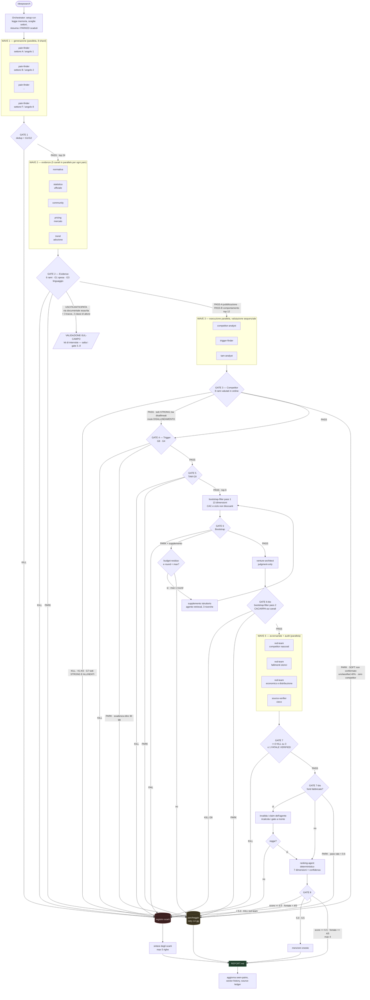
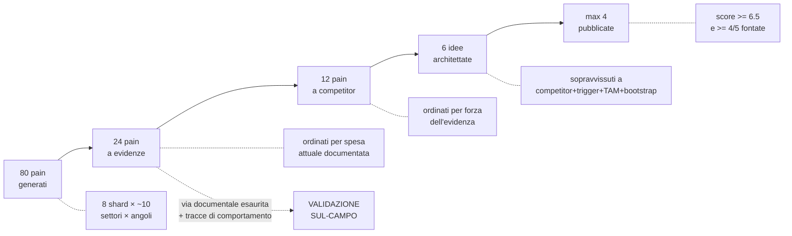
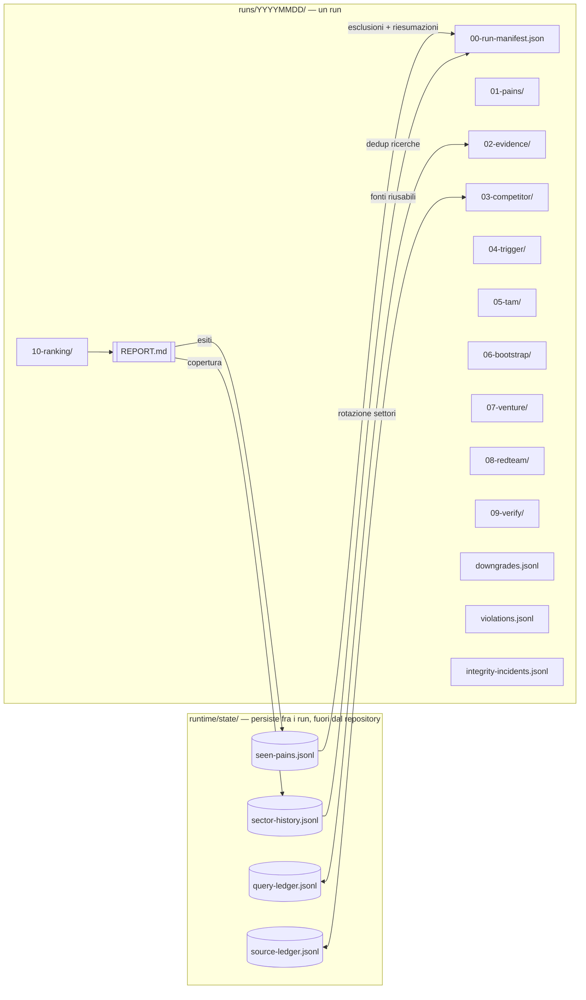

# DEEPSEARCH — Architettura della pipeline

> **DOCUMENTO DERIVATO — non e' la specifica.** Le regole vincolanti vivono in
> `config/deepsearch.config.json`, in `.claude/commands/deepsearch.md` e negli schemi. In caso di
> divergenza vince la config, poi l'orchestratore. Se trovi una differenza fra questo file e quelli,
> e' un difetto di questo file. `tools/spec_check.py` verifica la presenza di questo riquadro.

## 1. Il principio che regge tutto

Un prompt monolitico chiede allo stesso modello, nello stesso contesto, di fare tre cose
incompatibili: **generare** idee, **cercare** prove a loro sostegno e **giudicare** se le prove
bastino. Chi genera vuole che l'idea sopravviva; chi cerca decide quando smettere di cercare; chi
giudica ha gia' letto l'idea e la trova convincente perche' l'ha appena scritta. E' un tribunale in
cui l'imputato e' anche il pubblico ministero e il giudice.

DEEPSEARCH separa i tre ruoli in agenti distinti, con contesti distinti e strumenti distinti.

> **Chi cerca non conclude. Chi conclude non cerca.**

Da questa singola regola discendono quasi tutte le scelte architetturali del sistema:
gli agenti retrieval-only non hanno il permesso di scrivere valutazioni; gli agenti judgment-only
non hanno strumenti di ricerca, quindi **non possono materialmente fabbricare una fonte**; il red
team ha un incentivo invertito; il verificatore lavora alla cieca senza sapere quale idea sta
controllando.

---

## 2. Mappa degli agenti

| # | Agente | Classe | Ricerca | Conclude | Parallelismo | Domanda |
|---|---|---|---|---|---|---|
| 1 | `pain-finder` | generativo vincolato | SI | solo candidati | 4-8 shard (da profilo) | — |
| 2 | `evidence-researcher` | retrieval-only | SI | NO | 5 canali × N pain | Q4 |
| 3 | `competitor-analyst` | retrieval-only | SI | NO (verdetto aritmetico) | 1 × N pain | Q2 |
| 4 | `trigger-finder` | retrieval-only | SI | NO | 1 × N pain | Q1 |
| 5 | `tam-analyst` | retrieval-only | SI | NO | 1 × N pain | — |
| 6 | `bootstrap-filter` | judgment-only | **NO** | SI | 1 × N idee | Q3 |
| 7 | `venture-architect` | judgment-only | **NO** | SI | 1 × N idee | — |
| 8 | `red-team` | avversariale | SI | solo verso il KILL | 3 lenti × N idee | Q5 |
| 9 | `ranking-agent` | judgment-only deterministico | **NO** | SI | 1 globale | conta |
| 10 | `source-verifier` | audit cieco | SI | solo su citazioni | 1 × N idee | — |
| — | `orchestrator` | coordinatore | NO | **applica i gate** | — | — |

L'agente 10 non era richiesto nella specifica: e' aggiunto perche' senza un controllo indipendente
delle citazioni l'invariante "ogni fatto ha una fonte" resta autodichiarato dallo stesso agente che
lo ha prodotto. Verificare e' diverso da promettere di aver verificato.

---

## 3. Diagramma dei flussi

---

## 4. Il funnel in numeri (profilo DEEP)

**Il ramo che esce dal gate 2 non e' una perdita del funnel: e' la seconda uscita.** I sette gate
fra il 2 e l'8 sono tarati su evidenza documentale — competitor da mappare, scadenze da citare,
popolazione da contare. Metterli davanti all'unico esito progettato per le nicchie **non
documentabili** significa costruire una porta e murarla, ed e' quello che faceva la v2.6 tenendo
`VALIDAZIONE-SUL-CAMPO` come ramo del gate 8.

Ogni stage e' un restringimento **motivato e registrato**. Ogni caduta finisce nella sintesi degli
scarti con il codice del criterio che l'ha causata, e in `runtime/state/seen-pains.jsonl` con il proprio
cooldown.

---

## 5. Struttura del parallelismo

```mermaid
gantt
    title Esecuzione di un run DEEP (schematica)
    dateFormat X
    axisFormat %s

    section Wave 1
    8 pain-finder in parallelo        :a1, 0, 6

    section Wave 2
    pain #1 — 5 canali                :b1, 6, 8
    pain #2 — 5 canali                :b2, 6, 8
    pain #3 — 5 canali (lotto 2)      :b3, 8, 8

    section Wave 3
    pain #1 — competitor+trigger+TAM  :c1, 14, 6
    pain #2 — competitor+trigger+TAM  :c2, 14, 6
    pain #3 — competitor+trigger+TAM  :c3, 16, 6

    section Wave 4-5
    bootstrap + architect             :d1, 20, 4

    section Wave 6
    3 red team + verifier             :e1, 24, 6

    section Wave 7
    ranking + report                  :f1, 30, 3
```

Tre livelli di parallelismo, con effetti diversi:

**Diversita' (wave 1).** Otto shard ciechi fra loro su coppie (settore, angolo) diverse. Non serve a
essere veloci: serve a impedire che un unico contesto converga su una sola famiglia di idee. Un
prompt monolitico produce quasi sempre varianti dello stesso pattern perche' i primi token
condizionano tutto il resto.

**Copertura (wave 2 e 6).** Cinque canali di evidenza, tre lenti di red team. Ogni istanza vede
solo il proprio angolo, quindi non puo' fermarsi perche' "un'altra ricerca ha gia' confermato".

**Latenza (wave 3).** Competitor, trigger e TAM non hanno dipendenze di dati: eseguirli in serie e'
solo attesa. Girano insieme, ma i **gate** restano nell'ordine prescritto e l'early abort spegne
gli altri due appena uno uccide.

Nota sul trade-off della wave 3: l'esecuzione parallela spreca token quando il primo gate uccide.
E' un compromesso esplicito, controllato da `config.parallelism.parallel_gate_execution`. In
profilo LIGHT conviene metterlo a `false`.

---

## 6. Perche' il pipelining batte il barrier

L'orchestratore **non** aspetta che tutti i pain finiscano la wave 2 prima di far partire la wave 3.
Un pain che ha completato le evidenze passa subito al gate successivo.

Con un barrier fra le wave, il tempo totale e' la somma degli stage piu' lenti. Con il pipelining
per singolo pain, e' la catena piu' lenta di un singolo pain. Su 24 pain con tempi molto variabili
(un pain normativo con 40 documenti da leggere costa 5 volte un pain di community), la differenza e'
sostanziale, e i pain veloci arrivano al ranking mentre i lenti stanno ancora cercando.

L'unico punto in cui serve davvero un barrier e' il **ranking**, che e' comparativo per natura.

---

## 7. Flusso dei dati e memoria

La memoria fra run e' la ragione per cui questa pipeline puo' girare ogni venerdi' senza degenerare.
Un sistema senza memoria riscopre gli stessi pain, ripete le stesse ricerche e ripropone le stesse
idee gia' scartate, con la stessa sicurezza della prima volta. Con `runtime/state/seen-pains.jsonl`:

- un pain ucciso non torna per 90 giorni, **salvo** che il trigger-finder rilevi un cambiamento
  normativo che invalida il motivo dello scarto;
- un pain parcheggiato torna dopo 14 giorni **allo stage in cui si era fermato**, con la lista
  puntuale delle verifiche mancanti — e' il meccanismo che trasforma "dati insufficienti" da vicolo
  cieco in coda di lavoro;
- un'idea pubblicata non torna per un anno;
- la rotazione dei settori garantisce copertura invece che ripetizione.

---

## 8. Anti-allucinazione: le nove difese

| # | Difesa | Contro cosa | Dove |
|---|---|---|---|
| 1 | Separazione retrieval/judgment | retrieval motivato | classi di agente |
| 2 | Agenti judgment **senza strumenti di ricerca** | fabbricazione di fonti (impossibile per costruzione) | frontmatter `tools:` |
| 3 | Source ledger con ID, snippet e data | citazioni vaghe, URL mai aperti | IC-1..IC-4 |
| 4 | Regole di promozione a fatto per tier | un post di forum trattato come dato | `fact_promotion_rules` |
| 5 | Tre stati con `UNKNOWN` di prima classe | riempimento dei buchi con plausibilita' | tutti gli schemi |
| 6 | Ricerca obbligatoria di prove contrarie | conferma selettiva | evidence-researcher, trigger-finder |
| 7 | Downgrade meccanico | autoindulgenza sulle proprie citazioni | orchestratore |
| 8 | Source verifier cieco | URL plausibili, perimetri slittati, date gonfiate | agente 10 |
| 9 | Moltiplicatore di confidenza | vincere con la retorica invece che con i dati | ranking-agent |

Le difese sono **stratificate a costo crescente**: la 2 costa zero perche' e' una proprieta'
strutturale, la 8 costa ricerche vere. Cosi' il grosso della protezione non consuma budget.

---

## 9. Portabilita' su altri runtime

L'architettura non dipende da Claude Code. Cio' che serve altrove:

- **Gemini CLI / Codex** — i file `.claude/agents/*.md` sono prompt di sistema autosufficienti:
  si copiano come system prompt di sessioni separate. Il ruolo di orchestratore diventa uno script
  che invoca le sessioni e applica i gate.
- **API con orchestrazione a codice** — gli schemi in `schemas/` sono JSON Schema standard: si
  usano direttamente come structured output / function calling. I gate sono espressi come
  condizioni booleane su campi, quindi si traducono in codice senza ambiguita'.
- **Deep Research providers** — utile come sostituto del solo `evidence-researcher`, mantenendo la
  pipeline per il resto. Attenzione: molti provider restituiscono sintesi gia' interpretate, che
  violano la separazione retrieval/judgment. In quel caso trattare il loro output come **fonte T2**
  e non come claim.
